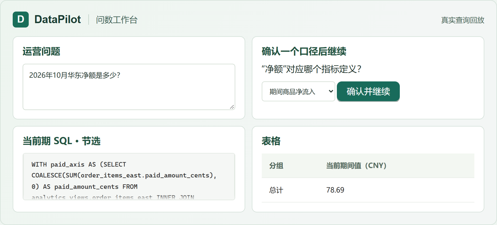

# DataPilot

**先把“净额”说清楚，再让模型写 SQL。**

“十月华东的净额是多少？” 按期间商品净流入算，是 **214.69 − 136.00 = 78.69 元**。前一项是十月实付的商品金额，后一项是十月成功退回的钱。演示数据里就有九月买、十月退的订单，这笔退款该扣在十月。[演示源数据](fixtures/datapilot/demo_v1.source.json)



*同一条真实模型查询的工作台回放，图中保留了 SQL 节选。* [截图说明](docs/local-development.md#截图是怎样得到的)

我把范围收在五张表、五个指标。做固定报表，用模板能省掉一次模型调用。这里保留模型写 SQL，是想看看用户已经说清了口径，模型还会在哪一步算错。

**技术栈**　React / TypeScript · FastAPI / LangGraph · SQLGlot / PostgreSQL · Celery / Redis

## 这五个指标怎么算？

| 指标 | 口径 |
| --- | --- |
| 支付商品金额 | 按支付成功时间，把订单明细的实付金额加起来。 |
| 支付订单数 | 在当前范围内按订单 ID 去重。一单买两件同类商品，算一单。 |
| 成功退款商品金额 | 按退款成功时间入账，包含以前月份支付、本月退回的钱。 |
| 期间商品净流入额 | 同期支付额减去同期成功退款额。某个品类这个月只有退款，也要保留负数。 |
| 支付客单价 | 整期实付金额除以去重支付订单数。有零元订单可以算出 0 元，没订单则返回空值。 |

数据来自客户、商品、订单、订单明细和退款五张表。每次问一个指标，可以按品类或销售区域拆分，看日、周、月趋势，选一个基期，或者取整期排名前几的分组。日期按上海时区算。[指标定义](apps/datapilot/catalog/metrics.v2.yaml)

确认后的指标、时间窗和分组会记进 `QuerySpec`。SQLGlot 解析模型给出的 SQL，服务端核对表列、权限和指标口径，才会用 PostgreSQL 的授权视图执行查询。工作台能展开口径和 SQL，也可以接着问“那十一月呢？”

## 踩过的坑

**一列空时间，差点把同一品类拆成两行。** 有道题问“十月每周各品类的净流入，跟九月同品类整月相比怎么样？”十月要按周和品类合并支付、退款，九月只按品类。旧版漏掉了九月结果里的时间列。模型补上 `NULL` 时，顺手又把它写进了 `JOIN`。两个 `NULL` 做等值比较配不上，同一品类的支付和退款也会各占一行。那条 SQL 在执行前被拦下了。后来我给每一期单独列出了输出列和关联键。九月还是要输出空时间，但合并两侧金额只看品类。[生成两期约束的代码](datapilot/model/prompts.py)

第一轮真实模型联调只过了 **11/12**。扣分的是一道权限题。华东账号要求查西部，系统拒绝了，根本没执行 SQL。翻回预期文件才发现，我填了内部异常名 `SCOPE_FORBIDDEN`，API 约定返回的却是 `FORBIDDEN_SCOPE`。下一轮先按公开接口写好预期，再把同样十二题各提交一次。**这次是 12/12**。十一道问数题都选对了口径，结果也和从订单、退款明细重算的数字一致。第十二题按预期拒绝越权。这一轮调用模型 24 次，没有触发模型的 SQL 修正。首轮的 11/12 仍按原样记录。

订单放大到十万笔，再把时间窗拉长，按月份和销售区域算客单价的 20 次正式执行全都超时。看执行计划，数据库在嵌套循环里反复扫商品明细。我保留原 SQL、数据和两秒上限，在只读事务里设了 `SET LOCAL enable_nestloop=off`，让优化器在有其他可行方案时避开嵌套循环。重跑这组查询，超时从 **20 次降到 0**，各组客单价也和订单明细对上了。再看整个容量矩阵，**480/480 次正式执行的结果都正确**，另有 96 次预热。[事务里的设置](datapilot/executor.py)

## 跑起来

准备 Git、Python 3.12 和带 Compose v2 的 Docker（Linux 容器）。以下命令都从仓库根目录运行。用 ZIP 下载的，先在解压目录执行 `git init`。

```sh
python scripts/init-local-env.py
docker compose -p datapilot --env-file .env.local -f apps/datapilot/compose.yaml up -d --wait postgres redis
docker compose -p datapilot --env-file .env.local -f apps/datapilot/compose.yaml --profile manage run --rm --build manage initialize --dataset demo_v1
docker compose -p datapilot --env-file .env.local -f apps/datapilot/compose.yaml --profile application up -d --build api web
```

打开 [本地工作台](http://localhost:18081)，用 `east_a` 登录。密码是初始化时随机生成的，在本机 `.env.local` 的 `DP_SEED_PASSWORD` 里。到这里就能看指标目录。上面的 78.69 元对应 `demo_v1`，首次安装请选择这个数据集。

**要让模型回答问题**，先在终端的隐藏输入框里填入自己的 DeepSeek API 密钥。调用使用你在提供方的额度。

```sh
python scripts/configure-deepseek.py --env-file .env.local --set-key
```

录入后，在本机 `.env.local` 把 `DP_MODEL_MODE` 改成 `live`、`DP_QUERY_PROCESSING_ENABLED` 改成 `1`。账号需要有 `deepseek-flash` 的访问权限。然后启动 worker 和控制进程，让 API 重新加载这两个开关。

```sh
docker compose -p datapilot --env-file .env.local -f apps/datapilot/compose.yaml --profile application --profile processing up -d --build api web worker control
```

现在试着问“2026 年 10 月华东净额是多少”，在澄清选项里选“期间商品净流入额”。要复核退款那一项，可以再问“2026 年 10 月华东成功退款商品金额是多少”，应当看到 **136.00 元**。

等查询跑完再停服务，下面的命令会保留数据卷。

```sh
docker compose -p datapilot --env-file .env.local -f apps/datapilot/compose.yaml --profile application --profile processing stop
```

使用 HTTPS 或想单独跑前端测试和构建，可以按[部署与前端验证说明](docs/local-development.md)操作。

## 验证到哪一步了？

- v6 本机回归通过了 **1,777 个 Python 测试节点**，其中 589 个带集成测试标记。另有 8 项前端状态测试和 19 项安装检查通过。
- 连续运行固定 SQL 600 秒，**889/889 个任务**的结果与源行计算一致。这一轮没有调用模型。
- 真实模型验收用的是预先写好的场景。尚无独立盲测准确率。
